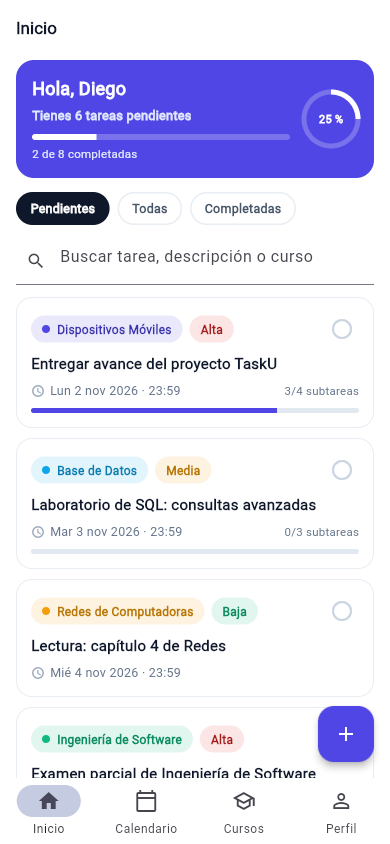
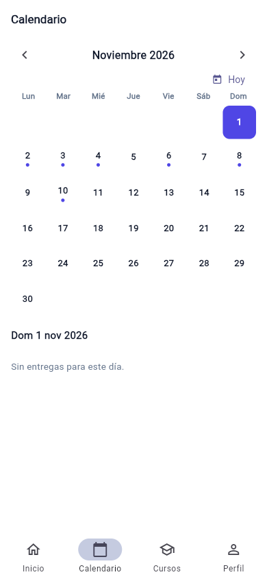
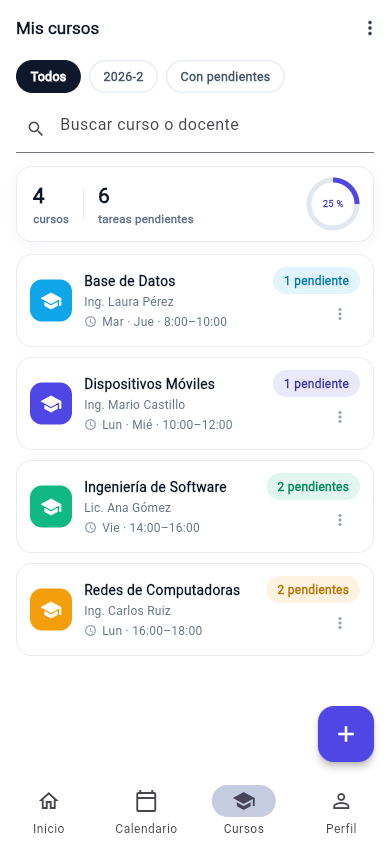
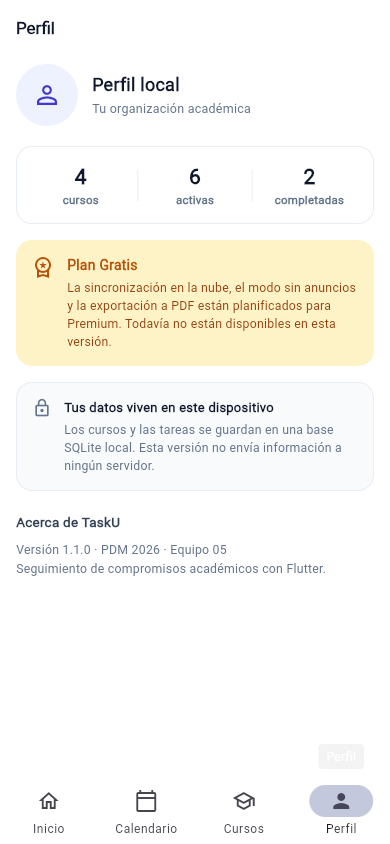

# Unitasks - Equipo 05

Bienvenido al repositorio oficial del **Equipo 05** para el proyecto Unitasks (PDM 2026).

## Integrantes del Equipo

| Carnet | Nombre Completo |
| :---: | :--- |
| **202208011** | Juan José Efraín Martínez Delgado |
| **202308063** | Demy Brictany De León Figueroa |
| **202308022** | Marco Pablo Sigüenza Orozco |
| **202308036** | Adrián Pablo Girón Franco |

## TaskU · la aplicación

Aplicación desarrollada en **Flutter** para el seguimiento de compromisos académicos, como tareas, exámenes y proyectos. Permite registrar actividades, consultar una agenda, gestionar recordatorios dentro de la aplicación y almacenar la información localmente en el dispositivo.

La aplicación funciona sin conexión a Internet y no requiere enviar los datos a un servidor.

**Versión actual: 1.2.0** (`pubspec.yaml` → `1.2.0+3`).

### Qué funciona hoy

| Pantalla | Archivo | Qué hace |
|---|---|---|
| 1 · Pendientes (`Inicio`) | `lib/screens/task_list_screen.dart` | Lista de tareas guardadas, búsqueda por título, descripción y nombre del curso, filtros Pendientes/Todas/Completadas combinables con la búsqueda, resumen y avance, marca rápida como completada, recordatorios vencidos dentro de la aplicación y botón + para registrar tareas. |
| 2 · Nueva / editar tarea | `lib/screens/task_form_screen.dart` | Título obligatorio, curso, tipo, prioridad, fecha y hora, recordatorio y descripción. El mismo formulario permite crear y editar tareas. |
| 3 · Calendario | `lib/screens/calendar_screen.dart` | Mes navegable, días con entregas, agenda del día seleccionado y acceso al detalle de cada tarea. |
| 4A · Detalle de tarea | `lib/screens/task_detail_screen.dart` | Información del curso, prioridad, tipo, fecha, recordatorio y estado; descripción; subtareas con progreso; completar/reabrir, editar y eliminar. **Cada cambio se guarda al instante.** |
| 4B · Gestión de cursos | `lib/screens/course_list_screen.dart` | Filtros (Todos · 2026-2 · Con pendientes), búsqueda local, resumen del semestre con anillo de avance, tarjetas con conteos calculados desde las tareas, editar, eliminar con «Deshacer» y agregar. |
| 4C · Registrar / editar curso | `lib/screens/course_form_screen.dart` | Nombre, docente, color, días, horario y periodo. |
| Perfil | `lib/screens/profile_screen.dart` | Datos de la cuenta local, conteos reales, aviso de almacenamiento local y estado del plan. |

### Búsqueda de tareas

La pantalla Inicio incorpora un buscador que permite localizar tareas utilizando los siguientes criterios:

- Título de la tarea.
- Descripción de la tarea.
- Nombre del curso asociado.

La búsqueda no distingue entre mayúsculas y minúsculas y se actualiza conforme se escribe el texto.

También puede utilizarse junto con los filtros **Pendientes, Todas y Completadas**, sin modificar el funcionamiento de estos.

Cuando no existen resultados, se muestra el mensaje «No hay tareas con ese texto». El usuario puede limpiar la búsqueda para visualizar nuevamente las tareas correspondientes al filtro seleccionado.

Esta funcionalidad se implementó sin modificar el esquema de la base de datos.

### Persistencia

- **Motor:** Drift 2.35 sobre SQLite (`drift` + `drift_flutter`). En móvil y escritorio utiliza `tasku.sqlite`; en web utiliza SQLite compilado a WebAssembly (WASM).
- **Esquema v2:** tablas `courses`, `tasks`, `subtasks` y `reminders`, con claves foráneas (`RESTRICT` de tareas hacia curso y `CASCADE` de subtareas y recordatorios) e índices por curso y fecha de entrega.
- **Migraciones:** el esquema se versiona mediante `schemaVersion`. La migración v1 → v2 incorpora `courses.archivado`, con valor predeterminado `false`, y se verifica en `test/data/migracion_test.dart`.
- **Datos iniciales:** la primera ejecución carga cuatro cursos y ocho tareas de ejemplo desde `seed_data.dart`, una sola vez, mediante `onCreate`.
- **Flujo de datos:** el recorrido pantalla → repositorio → DAO → SQLite → stream → pantalla se documenta en la [ADR 0003](../docs/adr/0003-flujo-de-datos-y-migraciones.md).

### Reglas de negocio implementadas

- **Un curso con tareas no puede eliminarse.** El sistema informa cuántas tareas tiene asociadas para evitar la pérdida de información. Un curso vacío puede eliminarse y recuperarse mediante «Deshacer».
- **Los pendientes y el avance se calculan** a partir de las tareas almacenadas; los cursos no mantienen contadores independientes.
- **Completar una tarea** marca también todas sus subtareas. Desmarcar una subtarea permite reabrir la tarea.
- **Los recordatorios se calculan** a partir de la fecha de entrega y se muestran dentro de la aplicación cuando vencen. Las notificaciones del sistema todavía no están implementadas.

### Arquitectura

```text
lib/
├── main.dart                 # Arranque, base local y ProviderScope
├── theme.dart                # Paleta y tema Material 3
├── models/
│   ├── course.dart           # Course (incluye archivado)
│   ├── course_summary.dart   # Curso + pendientes/total calculados
│   ├── course_filter.dart    # Filtro inmutable de cursos
│   └── task.dart             # Task, Subtask, enums y recordatorios
├── data/
│   ├── db/
│   │   ├── app_database.dart # Esquema v2 y migraciones
│   │   ├── tablas.dart       # Courses, tasks, subtasks, reminders
│   │   ├── cursos_dao.dart
│   │   └── tareas_dao.dart
│   ├── course_repository.dart
│   ├── task_repository.dart
│   ├── drift_course_repository.dart
│   ├── drift_task_repository.dart
│   └── seed_data.dart
├── providers/
│   └── providers.dart        # Repositorios y listas reactivas (Riverpod)
├── screens/                  # Inicio, calendario, cursos, perfil y formularios
├── utils/                    # Fechas en español e identificadores locales
└── widgets/                  # InfoChip, PrimaryButton, EstadoVista
```

La decisión de persistencia y sus consecuencias se encuentran documentadas en la [ADR 0002](../docs/adr/0002-persistencia-drift-riverpod.md).

El flujo de datos y la migración del esquema v2 se describen en la [ADR 0003](../docs/adr/0003-flujo-de-datos-y-migraciones.md).

## Cómo ejecutar

### Requisitos

- Flutter SDK instalado y configurado.
- Dart SDK compatible con el proyecto.
- Visual Studio Code, Android Studio u otro editor compatible con Flutter.
- Chrome para ejecutar la versión web.
- Emulador o dispositivo compatible para ejecutar la aplicación móvil.

### Instalación y ejecución

Desde la carpeta principal del repositorio, ingresar al proyecto Flutter:

```bash
cd "Proyecto final"
```

Instalar las dependencias:

```bash
flutter pub get
```

Para ejecutar en un emulador o dispositivo conectado:

```bash
flutter run
```

Para ejecutar en Chrome:

```bash
flutter run -d chrome
```

### Configuración de SQLite en Flutter Web

En Flutter Web, Drift utiliza SQLite compilado a WebAssembly (WASM).

Para permitir la inicialización de la base de datos en el navegador, se incluyen los siguientes archivos dentro de `web/`:

- `sqlite3.wasm`: módulo WebAssembly utilizado por SQLite.
- `drift_worker.js`: archivo utilizado para ejecutar operaciones de Drift en el entorno web.

Estos recursos permiten ejecutar la aplicación en Chrome sin requerir un servidor de base de datos externo.

La compilación web se verificó con `flutter build web --release`. El recorrido manual en navegador y en Android queda registrado en la [matriz de pruebas](../docs/qa-matriz.md).

## Verificación

Resultados de la verificación del 2026-11-03 en la rama `feat/cierre-sprint3`:

- `dart format --output=none --set-exit-if-changed lib test` → 0 archivos por cambiar.
- `dart analyze lib test` → **0 observaciones**.
- `flutter test` → **89 pruebas automatizadas aprobadas**, incluyendo las nuevas pruebas de Calendario y del estado de error con «Reintentar» en Inicio.
- `flutter build web --release` → compilación web correcta.
- `flutter build apk --release` → **APK release generado localmente** (57.8 MB, versión `1.2.0`, firma debug). Está en `build/app/outputs/flutter-apk/app-release.apk` y en el escritorio como `TaskU-1.2.0.apk`; falta instalarlo en un teléfono o emulador.

La matriz completa, con la distinción entre lo automatizado y lo pendiente, está en [`docs/qa-matriz.md`](../docs/qa-matriz.md).

Las pruebas específicas del buscador se encuentran en `test/task_list_search_test.dart`.

El flujo de integración continua (`.github/workflows/ci.yml`) ejecuta verificaciones de formato, análisis, pruebas automatizadas y compilación web para `Proyecto final`.

## Pendiente / siguiente paso

| Tema | Estado |
|---|---|
| Notificaciones del sistema (Android/iOS) | Pendiente. Actualmente los recordatorios se muestran dentro de la aplicación. Requiere `flutter_local_notifications`, `timezone`, permisos y configuración por plataforma. |
| Freemium (límite de 3 tareas activas) | Pendiente. El Perfil muestra el plan, pero todavía no se implementan compras ni restricciones de Premium. |
| Sincronización en la nube y exportación a PDF | Pendiente. Son funcionalidades previstas para Premium y requieren backend, autenticación y generación de PDF. |
| Icono de la aplicación | Se mantiene el icono predeterminado de Flutter; falta incorporar el diseño definitivo. |
| Validación con 3 personas reales | Pendiente (**0/3** en [`docs/usuarios.md`](../docs/usuarios.md)). Es requisito de la exposición. |
| APK e instalación en Android | APK compilado localmente (versión 1.2.0); falta instalarlo en un teléfono o emulador y probar el recorrido. |
| Pruebas en dispositivo físico | Pendiente de verificación por el equipo en Android/iOS. |

## Historial de módulos

- **Módulo 4** (4A detalle, 4B cursos y 4C formulario de curso) y **módulo 2** (formulario de tarea): base visual de la aplicación.
- **Versión 1.1.0:** se sustituyeron los datos de demostración en memoria por persistencia con Hive, se conectaron los flujos y se incorporaron Inicio, Calendario y Perfil. Consultar la entrada del 2026-10-29 en la [bitácora de IA](../docs/bitacora-ia.md).
- **Versión 1.2.0:** migración de Hive a Drift + Riverpod, esquema v2 con `courses.archivado`, prueba de migración v1 → v2, 89 pruebas automatizadas y matriz de pruebas. El saludo de Inicio dejó de usar una identidad ficticia.
- **Búsqueda de tareas (Issue #19):** incorporación de búsqueda por título, descripción y curso, compatible con los filtros de estado, seis pruebas automatizadas y soporte SQLite Web para ejecutar la aplicación en Chrome. Implementación realizada en la rama `feat/busqueda-tareas`.
- **Perfil local y recuperación de errores (PR #25):** Perfil sin identidad ficticia, estados de carga, vacío y error con «Reintentar», y arranque que permite reintentar la apertura de la base sin borrar datos.

## Capturas de la aplicación (390 × 844)

Capturas del navegador con la app integrada; no son evidencia de tres usuarios ni de ejecución en Android.

| Inicio | Calendario |
|---|---|
|  |  |

| Cursos | Perfil local |
|---|---|
|  |  |

El aporte UX sustituye la identidad ficticia del Perfil y agrega recuperación ante errores sin alterar la base. El protocolo de validación, todavía pendiente de ejecutar con tres personas reales, está en [usuarios.md](../docs/usuarios.md). Ver el [guion UX de Pablo](../docs/guion-ux-pablo.md).
