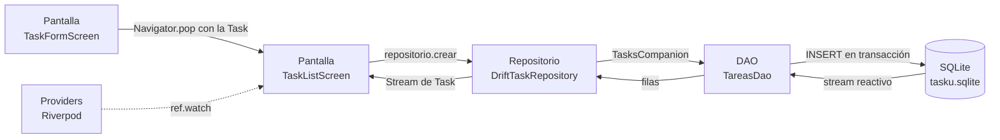

# ADR 0003 · Flujo de datos y migraciones del esquema

- **Estado:** aceptada
- **Fecha:** 2026-10-31
- **Relacionadas:** [ADR 0002](0002-persistencia-drift-riverpod.md) (Drift + Riverpod)

## Contexto

TaskU ya guarda cursos, tareas, subtareas y recordatorios en SQLite con Drift.
Falta dejar explícito **cómo viaja un dato** desde que el estudiante toca la
pantalla hasta que queda en la base, **qué pasa si algo falla** y **cómo se
aplican los cambios de esquema**. Esta ADR responde esas preguntas para la
exposición y para quien retome el proyecto.

## Decisión

### 1. Capas y responsabilidades

| Capa | Archivo | Responsabilidad |
|---|---|---|
| Pantalla | `lib/screens/*.dart` | Captura la acción, valida lo básico y muestra el resultado. No escribe SQL. |
| Estado | `lib/providers/providers.dart` | Expone la base, los repositorios y las listas reactivas con Riverpod. |
| Repositorio | `lib/data/drift_*_repository.dart` | Aplica reglas de negocio y traduce entre modelos y filas de la base. |
| DAO | `lib/data/db/*_dao.dart` | Ejecuta las consultas de Drift. Es la única capa que conoce SQL. |
| Base | `lib/data/db/app_database.dart` + `tablas.dart` | Esquema, versiones y migraciones. |

### 2. Recorrido de un dato: crear una tarea



1. `TaskFormScreen` valida el título y devuelve una `Task` por `Navigator.pop`.
2. `TaskListScreen` recibe la tarea y llama a `repositorio.crear(tarea)`.
3. `DriftTaskRepository` convierte la `Task` en `TasksCompanion` y llama al DAO.
4. `TareasDao` escribe la tarea, sus subtareas y su recordatorio en **una sola
   transacción**: o se guarda todo, o no se guarda nada.
5. SQLite deja los datos en `tasku.sqlite`.
6. Drift vuelve a emitir el stream de `watchTareas`; el repositorio mapea las
   filas a modelos `Task`.
7. La pantalla recibe la lista nueva y actualiza la interfaz.

### 3. Lectura y reactividad

- `watchTareas` hace un `JOIN` con cursos, subtareas y recordatorios, así el
  stream se dispara también cuando cambia una subtarea o un recordatorio.
- Los pendientes y el avance **se calculan** desde las tareas; no hay
  contadores escritos a mano que se puedan desincronizar.
- Las pantallas que hoy usan `setState` vuelven a leer al abrirse; `main.dart`
  y las pruebas usan los providers con `ref.watch`.

### 4. Errores

| Situación | Qué ocurre |
|---|---|
| Borrar un curso con tareas | El repositorio lanza `CursoConTareasException` con el número de tareas. La clave foránea `RESTRICT` es la segunda barrera. |
| Actualizar una tarea que ya no existe | `TareaNoEncontradaException`. |
| La base no abre al arrancar | `main.dart` captura el error y muestra la pantalla «No pudimos abrir tus datos locales». |
| Falla una carga en una pantalla | Se muestra `EstadoVista` con el botón «Reintentar». |
| Falla un guardado | La pantalla avisa con un `SnackBar` y conserva los datos del formulario. |

### 5. Migraciones

- `AppDatabase.schemaVersion = 3` (era 2 hasta la versión 1.2.1). La v3 agrega
  `app_settings`; ver [ADR 0004](0004-anuncios-y-premium.md).
- La migración v1 → v2 agrega `courses.archivado` con valor `false`:

  ```dart
  onUpgrade: (m, from, to) async {
    if (from < 2) {
      await m.addColumn(courses, courses.archivado);
    }
  },
  ```

- La prueba `test/data/migracion_test.dart` crea una base v1 con un curso,
  la abre con la versión 2 y comprueba que:
  1. el curso y sus días siguen ahí,
  2. `archivado` queda en `false`,
  3. `PRAGMA user_version` termina en `2`.
- Para el próximo cambio: subir `schemaVersion`, agregar el paso en
  `onUpgrade`, correr `dart run build_runner build` y agregar su prueba.

### 6. Estado de Riverpod (deuda técnica documentada)

- Los providers ya existen (`databaseProvider`, `courseRepositoryProvider`,
  `taskRepositoryProvider`, `cursosProvider`, `tareasProvider`, etc.).
- `main.dart` sobrescribe `databaseProvider` con la base real y pasa los
  repositorios a `HomeShell`; las pantallas los reciben por constructor y
  guardan su propia copia con `setState`.
- **Decisión para este sprint:** mantener la inyección por constructor porque
  las pantallas no conocen SQL, son fáciles de probar con fakes y la demo no
  corre riesgo. **Pendiente:** migrar las pantallas a `ref.watch` para que
  todas compartan un único origen de verdad.
- La rúbrica exige que la pantalla no hable directo con la base: se cumple,
  porque toda lectura y escritura pasa por el repositorio.
- **No es MVVM:** es una arquitectura por capas con repositorios y providers.
  No hay una capa de ViewModel separada.

## Consecuencias

**A favor**

- Un solo lugar conoce SQL (`lib/data/db/`).
- Las reglas de negocio viven en el repositorio y se pueden probar sin pantalla.
- Las migraciones están versionadas y probadas.
- Los errores tienen un mensaje para el usuario, no un stack trace.

**En contra**

- Las pantallas todavía duplican estado local; hay dos formas de leer datos
  (constructor y providers) hasta que se complete la migración a Riverpod.
- La web necesita `sqlite3.wasm` y `drift_worker.js` en `web/`; hoy faltan.
